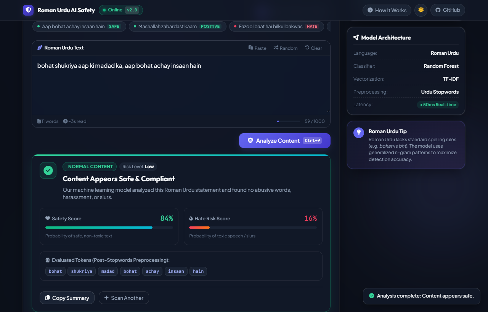
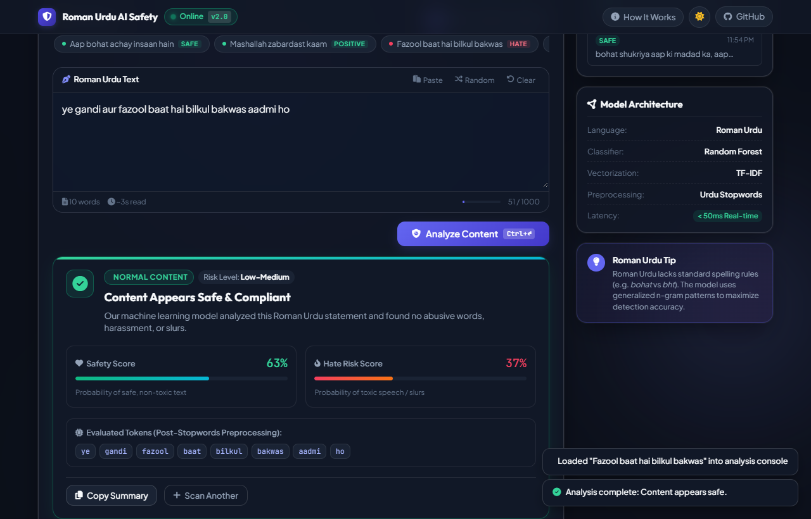
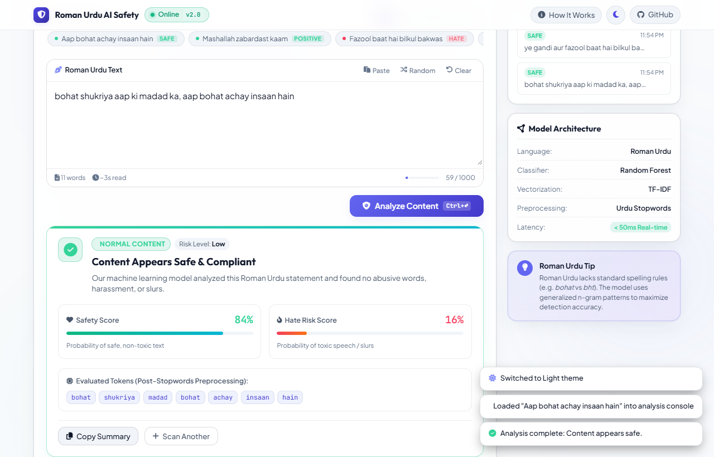

# Roman Urdu Hate Speech Detection


An AI-powered machine learning web application engineered to detect and classify hate speech, abusive language, and toxic content in **Roman Urdu** text. Equipped with real-time inference, probabilistic confidence scoring, token transparency, dark/light themes, and a responsive interface.

---

## 📋 Table of Contents
- [Overview](#-overview)
- [✨ Key Features](#-key-features)
- [🎬 Interface Previews & Screenshots](#-interface-previews--screenshots)
- [🧠 Machine Learning & NLP Pipeline](#-machine-learning--nlp-pipeline)
- [🛠️ Technology Stack](#-technology-stack)
- [📁 Project Structure](#-project-structure)
- [🚀 Quick Start & Installation](#-quick-start--installation)
- [💻 Usage & REST API](#-usage--rest-api)
- [🤝 Contributing](#-contributing)
- [📄 License](#-license)

---

## 🔍 Overview

Roman Urdu (Urdu written in the Latin script) is widely used across social media platforms like Twitter/X, Facebook, WhatsApp, and Reddit. Due to the lack of standardized spelling conventions and vocabulary in Roman Urdu, conventional English or Arabic-script Urdu toxic content filters fail.

This project implements a custom Natural Language Processing (NLP) pipeline and an ensemble machine learning classifier trained specifically on Roman Urdu tweets. It delivers real-time safety classification, detailed probability meters, token-level transparency, and a modern dashboard.

---

## ✨ Key Features

- **⚡ Instant Real-Time Analysis (< 50ms)**: Submits text via asynchronous AJAX with a glowing laser scanner radar beam without full page reloads.
- **📊 Dual Probability & Risk Scoring**: Computes exact percentage probabilities for **Safety Score** vs. **Hate Risk Score**, complete with severity risk tags (*Low Risk*, *Moderate Risk*, *High Risk*).
- **🔬 Evaluated Token Inspector**: Displays preprocessed semantic tokens evaluated by the model after Roman Urdu stopword removal.
- **🌓 Dark & Light Mode Support**: Built-in theme switcher with smooth transitions and persistent browser storage.
- **🎯 Categorized Quick Presets**: Test instantly with 1-click preset samples categorized by *Safe / Compliments*, *Hateful / Abusive*, and *Neutral Statements*.
- **🛠️ Productivity Tools**:
  - 📋 **Paste from Clipboard** button
  - 🎲 **Random Sample Generator**
  - 🧹 **Clear Console** (<kbd>Esc</kbd>)
  - ⌨️ **Keyboard Shortcut** (<kbd>Ctrl</kbd> + <kbd>↵</kbd> / <kbd>Cmd</kbd> + <kbd>↵</kbd>)
  - 📋 **Copy Formatted Moderation Report** with 1-click clipboard integration
- **🕒 Session History Drawer**: Automatically tracks recent scans in the session with 1-click reload and classification badges.
- **📖 "How It Works" Glass Modal**: In-app architectural breakdown explaining each step from regex tokenization to random forest decision trees.
- **📱 Fully Responsive Design**: Fluid layout tested across ultrawide monitors, standard laptops, tablets, and mobile devices.

---

## 🎬 Interface Previews & Screenshots

### 1. Main Dashboard & Safe Content Analysis (Dark Mode)
The streamlined interface analyzing compliant Roman Urdu text, displaying safety confidence scores and preprocessed tokens.



### 2. Hate Speech & Toxic Content Detection
Instant detection of abusive language with high risk flags, danger badges, and hate probability meters.



### 3. Light Mode Theme
Clean, high-contrast light theme with polished typography and accessible components.



---

## 🧠 Machine Learning & NLP Pipeline

```
Raw Roman Urdu Text
        │
        ▼
1. Text Cleaning & Normalization (Regex, Lowercase, Punctuation Stripping)
        │
        ▼
2. Custom Stopword Removal (aur, hai, ke, ka, ki, ko, the, main, tum, wo, etc.)
        │
        ▼
3. TF-IDF Feature Extraction (High-dimensional n-gram feature projection)
        │
        ▼
4. Random Forest Classifier Ensemble (Decision tree majority voting)
        │
        ▼
Label Output: [Normal Tweet vs. Hateful Tweet] + Exact Confidence Probabilities
```

---

## 🛠️ Technology Stack

| Layer | Technologies |
|---|---|
| **Frontend** | HTML5, CSS3 (Modern Glassmorphism & Custom Properties), Vanilla JavaScript (ES6+), FontAwesome 6, Google Fonts (*Outfit*, *Plus Jakarta Sans*, *JetBrains Mono*) |
| **Backend** | Python 3, Flask, Jinja2 Templates |
| **Machine Learning** | scikit-learn, Random Forest Classifier, TF-IDF Vectorizer |
| **NLP** | Custom Regex Tokenizer & Roman Urdu Stopword Lexicon |
| **Automation & Testing** | Playwright (Headless UI verification & screenshot automation) |

---

## 📁 Project Structure

```
roman_urdu_hate_speech/
│
├── app/                              # Flask Application Package
│   ├── __init__.py                   # App factory & folder path configuration
│   ├── routes.py                     # Web endpoints & /api/analyze JSON route
│   ├── utils.py                      # Roman Urdu NLP preprocessing & stopword filter
│   ├── static/                       # Mirrored static assets
│   │   ├── css/styles.css            # Stylesheet
│   │   ├── js/app.js                 # Frontend interactive logic
│   │   └── img/                      # UI screenshots & preview assets
│   └── templates/
│       └── index.html                # Mirrored UI template
│
├── models/                           # Serialized Machine Learning Models
│   ├── model.pkl                     # Trained Random Forest classifier
│   └── vectorizer.pkl                # Trained TF-IDF text vectorizer
│
├── static/                           # Project Static Assets
│   ├── css/styles.css                # Modern responsive design system
│   ├── js/app.js                     # Core application engine
│   └── img/                          # High-resolution screenshots
│
├── templates/
│   └── index.html                    # Main HTML5 application interface
│
├── data/                             # Datasets
│   ├── Dataset.csv                   # Raw Roman Urdu dataset
│   └── Preprocessed_Dataset.csv      # Cleaned and processed dataset
│
├── notebooks/                        # Jupyter Notebooks
│   └── Hate_Speech_Detection.ipynb   # Model training, analysis & evaluation
│
├── config.py                         # Environment configuration settings
├── requirements.txt                  # Python dependencies
├── run.py                            # Application entry point
├── sample dataset.txt                # Sample Roman Urdu sentences for testing
└── README.md                         # Project documentation
```

---

## 🚀 Quick Start & Installation

### Prerequisites
- Python 3.8 or higher installed on your system.

### 1. Clone the Repository
```bash
git clone https://github.com/hassanrrraza/hatefull-speech-detection.git
cd hatefull-speech-detection
```

### 2. Set Up a Virtual Environment
```bash
# Windows
python -m venv venv
venv\Scripts\activate

# macOS / Linux
python3 -m venv venv
source venv/bin/activate
```

### 3. Install Dependencies
```bash
pip install -r requirements.txt
```

### 4. Run the Application
```bash
python run.py
```

### 5. Access the Web Interface
Open your browser and navigate to:
```
http://127.0.0.1:5000/
```

---

## 💻 Usage & REST API

### Web Interface
1. Type or paste Roman Urdu text into the console (or click any of the preset sample chips).
2. Click **Analyze Content** or press <kbd>Ctrl</kbd> + <kbd>Enter</kbd>.
3. View the classification verdict, safety vs. hate risk scores, and token insights.
4. Click **Copy Summary** to copy a formatted report to your clipboard.

### REST API Endpoint (`/api/analyze`)
You can integrate this hate speech detection model directly into your own applications via the JSON endpoint:

#### Request
```http
POST /api/analyze HTTP/1.1
Host: 127.0.0.1:5000
Content-Type: application/json

{
  "tweet": "ye bohat achi baat hai mashallah"
}
```

#### Response
```json
{
  "success": true,
  "prediction": "Normal Tweet",
  "is_hateful": false,
  "confidence": 94.0,
  "normal_probability": 94.0,
  "hate_probability": 6.0,
  "risk_level": "Low",
  "tokens": ["ye", "bohat", "achi", "baat", "mashallah"],
  "text": "ye bohat achi baat hai mashallah",
  "char_count": 31,
  "word_count": 6
}
```

---

## 🤝 Contributing

Contributions are welcomed! If you'd like to improve the model dataset, add more Roman Urdu stopwords, or enhance the interface:

1. Fork the Project
2. Create your Feature Branch (`git checkout -b feature/NewFeature`)
3. Commit your Changes (`git commit -m 'Add NewFeature'`)
4. Push to the Branch (`git push origin feature/NewFeature`)
5. Open a Pull Request

---

## 📄 License

Distributed under the **MIT License**. See `LICENSE` for more information.

&copy; 2026 **Hassan Raza**. All rights reserved.
